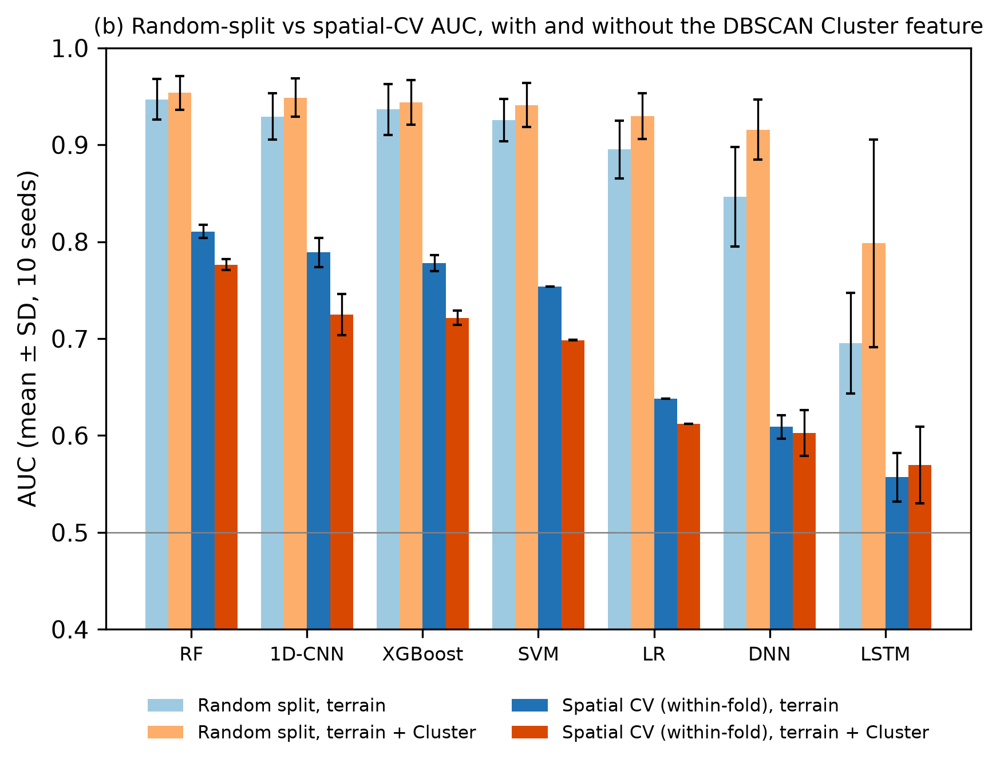

# Deep Learning for Landslide Susceptibility Mapping, Rangamati District (Bangladesh)

## Overview

This repository maps landslide susceptibility in Rangamati district, Bangladesh. Three deep models (DNN, 1D-CNN, LSTM) are compared with four classical baselines (Random Forest, XGBoost, SVM-RBF, Logistic Regression) on a sparse inventory of 196 landslides, evaluated with spatial block cross-validation.

The code reproduces the corrected, leakage-free evaluation (every learned preprocessing step is fitted inside the training fold) and supports the major revision of manuscript BOEG-D-26-02116: `src/revision_*.py` generate the numbers, tables and figures of the revised manuscript.

## Repository structure

```
.
├── src/                      # Python package (run with `python -m src.<module>` from the repo root)
│   ├── data.py               # loading, schema validation, row-level cleaning of the labelled dataset
│   ├── features.py           # fold-safe imputation, encoding, scaling, DBSCAN cluster encoder
│   ├── sampling.py           # SMOTE with post-hoc snapping of synthetic rows to the encoded feature space
│   ├── splits.py             # random 60/20/20 split (R1) and spatially blocked 5-fold CV (R2)
│   ├── models.py             # model constructors (7 models), each wrapped in a fold-safe pipeline; seeding
│   ├── evaluate.py           # metrics, within-fold vs pooled AUC convention, leakage diagnostics
│   ├── run.py                # entry point: reproduces the corrected tables (regimes R0/R1/R2)
│   ├── revision_analyses.py  # revision round 1: sparsity metrics, DBSCAN justification, 7 models x 3 feature sets, SHAP
│   ├── revision_extra.py     # extra analyses: fold weighting, 4-fold CV, bbox negatives, ablations, thresholds, ROC/map figures
│   ├── revision_rev2.py      # second-round sensitivity experiments (audit deepreview-2)
│   ├── revision_rev2_shap.py # second-round SHAP checks and figure fixes
│   ├── diagnostics_rev2.py   # second pre-submission audit: facts and small read-only diagnostics
│   ├── revision_rev3.py      # third-round analyses (A1-A10)
│   ├── raster_stack.py       # wall-to-wall 30 m conditioning-factor rasters from open data
│   └── raster_mapping.py     # RF+SMOTE refit on raster features, pixel map, AOA, class stats, Fig 15
├── tests/                    # test_feature_leakage.py (fold-safety of the fitted feature steps)
├── notebooks/                # original notebooks (legacy/original analysis):
│                             #   landslide_susceptibility_mapping.ipynb, Landslide_Susceptibility_With_BNN.ipynb
├── models/                   # *.joblib final terrain-only models
├── results/
│   ├── results_R0.csv, results_R1.csv, results_R2.csv   # corrected-pipeline tables (+ *.provenance.json)
│   ├── final_model_selection.csv, susceptibility_predictions.csv
│   ├── session*.md           # working notes of the audit sessions
│   ├── revision/             # revision outputs (extra/ holds the later rounds, incl. rev2/, rev2_shap/, rev3/;
│   │                         #   raster/ holds the raster-mapping tables and reports)
│   ├── revision_v1/          # archived earlier version
│   └── revision_pre_rev2/    # archived earlier version
├── reports/figures/
│   ├── study_area_map.jpg, lsm_by_cnn.png   # original figures
│   ├── revision/             # revised figures (revision/rev3/ for the third round)
│   ├── revision_v1/          # archived earlier version
│   └── revision_pre_rev2/    # archived earlier version
├── data/external/            # geoBoundaries district boundary (rangamati_geoboundaries_adm2.geojson)
├── docs/Presentation.pdf
├── logs/, logs_extra/, logs_rev2/, logs_rev2b/, logs_rev3/   # run logs
├── spatial_folds.csv, random_folds.csv                       # fold assignments
└── requirements.txt
```

## Installation

```bash
git clone https://github.com/murad-geoAi/DL_Application_for_Landslide_Susceptibility_Mapping.git
cd DL_Application_for_Landslide_Susceptibility_Mapping
python -m venv .venv
source .venv/bin/activate
pip install -r requirements.txt
```

Packages imported by the code but not listed in `requirements.txt`:

- `catboost`: imported only by `src/revision_rev2.py --part extra_models`.
- `geopandas` and `shapely`: used by the revision scripts (district boundary, maps, geodistance); they may already be present as dependencies of `esda`/`libpysal`, otherwise install them.
- `pytest`: needed to run the tests.
- `rasterio`, `requests`, `pyproj`, `pystac-client`, `planetary-computer`, `pysheds`: needed only by the raster-mapping scripts (`src/raster_stack.py`, `src/raster_mapping.py`).

`scipy` is imported directly but is installed with scikit-learn. LightGBM is not used.

## Data

The labelled dataset `Labeled Data Set.csv` is expected at the repository root (the default `--data` argument of every script). It is gitignored and not distributed with the repository; it is available from the authors on request. The code does not read `data/raw/`. The only bundled data file is the district boundary in `data/external/` (geoBoundaries gbOpen, Runfola et al. 2020).

## Core corrected pipeline

```bash
python -m src.run                                   # all regimes, all models
python -m src.run --regimes R1 R2 --models random_forest cnn1d --seed 42
python -m src.run --data "path/to/Labeled Data Set.csv"
```

Options: `--data` (default `Labeled Data Set.csv`), `--regimes R0 R1 R2`, `--models` (any of the seven model names), `--seed` (default 42), `--output-dir` (default `results`), `--models-dir` (default `models`), `--no-save-models`, `--no-deterministic-ops` (skip TensorFlow deterministic ops).

| Regime | Protocol |
|---|---|
| R0 | Original protocol, bugs included (DBSCAN and KNN imputation fit on the full data before splitting, test set used as validation data for early stopping). A documentation spot-check for DNN and 1D-CNN on the enhanced dataset only. Not a result. |
| R1 | Stratified random 60/20/20 split with preprocessing fit on train only, genuine validation partition, test set used once. Honest code, leaking split. |
| R2 | Spatially blocked 5-fold CV (`splits.spatial_block_cv`, `balance="both"`). The honest number. |

Feature sets: terrain-only (21 features) and terrain + `Cluster` (31). The final models in `models/` use terrain-only.

Outputs: `results/results_R0.csv`, `results_R1.csv`, `results_R2.csv` with `*.provenance.json` sidecars, and fitted models in `models/*.joblib`.

## Revision analyses (BOEG-D-26-02116, major revision)

All commands run from the repository root. Cross-validated results are reported as within-fold and pooled AUC (see `src/evaluate.py`).

### Round 1: `src/revision_analyses.py`

Produces every number, table and figure used in the revised manuscript. Outputs go to `results/revision/` and `reports/figures/revision/`. Parts: `descriptive`, `seeds`, `aggregate`, `shap`, `shapfig`, `negsens`.

```bash
# 1. sparsity metrics, DBSCAN justification, negative-sample geometry, flowchart, Gi*/Moran figures
python -m src.revision_analyses --part descriptive
# 2. spatial block CV + random-split reference for 7 models x 3 feature sets, one call per seed
python -m src.revision_analyses --part seeds --seeds 42 0 1 2 3 4 5 6 7 8
# 3. aggregate seeds -> summary tables, ROC / comparison / fold figures, susceptibility surface
python -m src.revision_analyses --part aggregate --map-model "1D-CNN|terrain"
# 4. out-of-fold Kernel SHAP for one model
python -m src.revision_analyses --part shap --shap-model cnn1d
```

Key points of the corrected evaluation:
- every learned preprocessing step (imputation, scaling, encoding, DBSCAN, SMOTE) is fitted inside the training fold;
- the primary metric is the within-fold AUC under spatial block CV (10 k-means blocks merged into 5 folds);
  pooled out-of-fold AUC is reported alongside but is sensitive to fold-wise class-prior shift;
- deep models are averaged over 10 seeds because single runs are unstable on 196 landslides;
- the district boundary (`data/external/rangamati_geoboundaries_adm2.geojson`) is from geoBoundaries gbOpen (Runfola et al. 2020).

### Extra analyses: `src/revision_extra.py`

Outputs go to `results/revision/extra/` and `reports/figures/revision/`. Per-seed results are cached in `results/revision/extra/parts/`.

    python -m src.revision_extra --part folds        # pair-weighted within-fold AUC; 4-fold CV variant
    python -m src.revision_extra --part bbox         # negatives restricted to the landslide bounding box
    python -m src.revision_extra --part ablation     # feature-group ablation + missingness diagnostics
    python -m src.revision_extra --part cnnorder     # 1D-CNN feature-order ablation
    python -m src.revision_extra --part thresholds   # fold-prior thresholds from OOF predictions
    python -m src.revision_extra --part roc          # Fig. 12 (within-fold) and pooled ROC
    python -m src.revision_extra --part geodist      # NNDM-style geodistance ECDFs
    python -m src.revision_extra --part map          # Fig. 15 point map with DI / AOA
    python -m src.revision_extra --part foldmap      # Fig. 13a fold map
    python -m src.revision_extra --part rabby        # overlap with Rabby & Li inventory (needs download)
    python -m src.revision_extra --part water        # re-run CV after dropping non-landslide points on water (LULC == 1)

`--seeds` selects seeds; the heavy parts can be split across processes by seed.

### Second round: `src/revision_rev2.py`

Outputs: `results/revision/extra/rev2/`, per-seed caches in `results/revision/extra/rev2/parts/`. Optional `--seeds` and `--models`.

    python -m src.revision_rev2 --part repro
    python -m src.revision_rev2 --part ablation_more
    python -m src.revision_rev2 --part spatial_es
    python -m src.revision_rev2 --part lstm_reg
    python -m src.revision_rev2 --part extra_models   # requires catboost

### Second-round SHAP checks: `src/revision_rev2_shap.py`

Writes only under `results/revision/extra/rev2_shap/` and new `*_v2.png` figures.

    python -m src.revision_rev2_shap --part cnn_grouped
    python -m src.revision_rev2_shap --part shap_checks
    python -m src.revision_rev2_shap --part figs
    python -m src.revision_rev2_shap --part summary

### Second pre-submission audit: `src/diagnostics_rev2.py`

    python -m src.diagnostics_rev2     # writes results/revision/extra/rev2_diagnostics.json and .md

### Third round: `src/revision_rev3.py`

Analyses A1-A10. Outputs: `results/revision/extra/rev3/` and `reports/figures/revision/rev3/`. One CSV per (part, seed) is cached in `results/revision/extra/rev3/parts/`.

    python -m src.revision_rev3 --part <name> [--seeds 42 0 1 ...] [--models ...]

Parts: `abl`, `cw`, `smotenc`, `dl_a`, `dl_b`, `shap_cnn`, `light` (A2, A3 rescale, A6 summary, A7, A8, A9), `figs`.

### Raster susceptibility map: `src/raster_stack.py`, `src/raster_mapping.py`

Builds the revised wall-to-wall map (Fig 15). `raster_stack.py` assembles the conditioning factors used by the final RandomForest (terrain + SMOTE) model on one common grid (30 m, EPSG:32646, district boundary + 1 km buffer) from open data: NASADEM terrain derivatives, Esri LULC (plus a water mask), Sentinel-2 NDVI, CRU TS rainfall and SoilGrids texture. Downloads are anonymous (Planetary Computer public STAC, public HTTP files) and cached under `data/rasters/raw/`.

    python -m src.raster_stack <step>      # dem, lulc, ndvi_points, ndvi_full, rain, soil, agree
    python -m src.raster_mapping <stage>   # table, cv, diag, aoa, stats, fig15, seams

`raster_mapping.py` samples the rasters at the 496 points, reruns spatial CV (10 seeds x 5 folds) with raster features against CSV-feature controls, predicts every valid pixel, computes the area of applicability (dissimilarity index + AOA mask), class breaks and statistics, and draws `reports/figures/revision/fig15_susceptibility_raster.png`. Tables and reports go to `results/revision/raster/`.

The rasters (`data/rasters/`, about 5.6 GB) and the cached pixel arrays (`results/revision/raster/mapping/*.npz`, `*.npy`) are not tracked in git; rerun the steps above to regenerate them.

## Reproducibility notes

- Seeds: 42 0 1 2 3 4 5 6 7 8 (deep models are averaged over these ten seeds).
- Heavy revision parts cache results per seed (per (part, seed) in `revision_rev3.py`), so an interrupted run resumes without recomputing finished seeds.
- `PYTHONHASHSEED` is set to 42 (via `os.environ.setdefault`) at the top of the run and revision modules; for a guaranteed hash seed, export it in the shell before the run. `src.run` also enables TensorFlow deterministic ops unless `--no-deterministic-ops` is given.
- Apple Silicon: TensorFlow's Metal GPU backend gives materially different DNN results (within-fold AUC about 0.61 on Metal versus about 0.78 on CPU). Run deep models on CPU to reproduce the reported numbers, for example `CUDA_VISIBLE_DEVICES=""` or by uninstalling/disabling `tensorflow-metal`. The code has no general device switch; the only mechanism in `src/` is `src/revision_rev3.py`, which hides the GPU (`tf.config.set_visible_devices([], "GPU")`) when the environment variable `REV3_CPU=1` is set (thread counts via `REV3_THREADS`, default 2). The other scripts use whatever device TensorFlow selects. Note that `CUDA_VISIBLE_DEVICES` has no effect on the Metal backend, so on Apple Silicon use `REV3_CPU=1` with `revision_rev3.py` or remove `tensorflow-metal`.

## Tests

```bash
python -m pytest tests/
```

`tests/test_feature_leakage.py` checks that the fitted feature steps (DBSCAN structure, imputer, one-hot vocabularies, SMOTE encodings) see training rows only. It also runs standalone: `python tests/test_feature_leakage.py`.

## Results

### Study area


### Revised susceptibility map


### Model comparison


## Citation

Manuscript under review (BOEG-D-26-02116). Citation details will be added upon publication.

## License

MIT, see [LICENSE](LICENSE).
