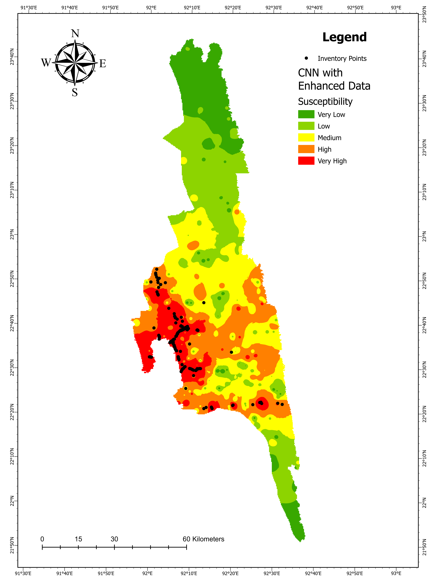

# Deep Learning Application for Landslide Susceptibility Mapping

## Overview
This research project applies Deep Learning techniques, specifically Convolutional Neural Networks (CNN), to map landslide susceptibility. The goal is to address spatial sparsity in data and provide accurate susceptibility maps to aid in disaster management and planning.

## Key Features
- **Deep Learning Model**: Utilizes CNNs to process spatial data for landslide prediction.
- **Data Preprocessing**: Handles missing values using KNN and Simple Imputers.
- **Visualization**: Generates susceptibility maps and analyzes feature distributions.

## Directory Structure
The repository is organized as follows:
```
├── data/
│   ├── raw/            # Original data (e.g., Labeled Data Set.csv)
│   └── processed/      # Cleaned and processed data
├── docs/               # Project documentation and presentations
├── notebooks/          # Jupyter notebooks for analysis and modeling
├── reports/            # Generated figures and reports
│   └── figures/
├── src/                # Source code (scripts, utilities)
├── README.md           # Project overview and instructions
└── requirements.txt    # Python dependencies
```

## Getting Started

### Prerequisites
- Python 3.8+
- Jupyter Notebook
- Dependencies listed in `requirements.txt`

### Installation
1. Clone the repository:
   ```bash
   git clone https://github.com/murad-geoAi/DL_Application_for_Landslide_Susceptibility_Mapping.git
   ```
2. Navigate to the project directory:
   ```bash
   cd DL_Application_for_Landslide_Susceptibility_Mapping
   ```
3. Install the required packages:
   ```bash
   pip install -r requirements.txt
   ```

### Data Setup
Place your dataset (e.g., `Labeled Data Set.csv`) in the `data/raw/` directory. The notebook expects the file at `../data/raw/Labeled Data Set.csv`.

### Usage
1. Launch Jupyter Notebook:
   ```bash
   jupyter notebook
   ```
2. Open `notebooks/landslide_susceptibility_mapping.ipynb`.
3. Run the cells to perform data cleaning, analysis, and model training.

## Results
### Study Area


### Landslide Susceptibility Map (CNN)


## License
[MIT License](LICENSE) (or appropriate license)

## Revision analyses (BOEG-D-26-02116, major revision)

`src/revision_analyses.py` produces every number, table and figure used in the revised manuscript.
Outputs go to `results/revision/` and `reports/figures/revision/`.

```bash
# 1. sparsity metrics, DBSCAN justification, negative-sample geometry, flowchart, Gi*/Moran figures
python -m src.revision_analyses --part descriptive
# 2. spatial block CV + random-split reference for 7 models x 3 feature sets, one call per seed
python -m src.revision_analyses --part seeds --seeds 42 0 1 2 3 4 5 6 7 8
# 3. aggregate seeds -> summary tables, ROC / comparison / fold figures, susceptibility surface
python -m src.revision_analyses --part aggregate --map-model "1D-CNN|terrain"
# 4. out-of-fold Kernel SHAP for one model
python -m src.revision_analyses --part shap --shap-model cnn1d
```

Key points of the corrected evaluation:
- every learned preprocessing step (imputation, scaling, encoding, DBSCAN, SMOTE) is fitted inside the training fold;
- the primary metric is the within-fold AUC under spatial block CV (10 k-means blocks merged into 5 folds);
  pooled out-of-fold AUC is reported alongside but is sensitive to fold-wise class-prior shift;
- deep models are averaged over 10 seeds because single runs are unstable on 196 landslides;
- the district boundary (`data/external/rangamati_geoboundaries_adm2.geojson`) is from geoBoundaries gbOpen (Runfola et al. 2020).

## Extra revision analyses (`src/revision_extra.py`)

Outputs go to `results/revision/extra/` and `reports/figures/revision/`. Per-seed results are cached in `results/revision/extra/parts/`.

    python -m src.revision_extra --part folds        # pair-weighted within-fold AUC; 4-fold CV variant
    python -m src.revision_extra --part bbox         # negatives restricted to the landslide bounding box
    python -m src.revision_extra --part ablation     # feature-group ablation + missingness diagnostics
    python -m src.revision_extra --part cnnorder     # 1D-CNN feature-order ablation
    python -m src.revision_extra --part thresholds   # fold-prior thresholds from OOF predictions
    python -m src.revision_extra --part roc          # Fig. 12 (within-fold) and pooled ROC
    python -m src.revision_extra --part geodist      # NNDM-style geodistance ECDFs
    python -m src.revision_extra --part map          # Fig. 15 point map with DI / AOA
    python -m src.revision_extra --part foldmap      # Fig. 13a fold map
    python -m src.revision_extra --part rabby        # overlap with Rabby & Li inventory (needs download)

`--seeds` selects seeds; the heavy parts can be split across processes by seed.
